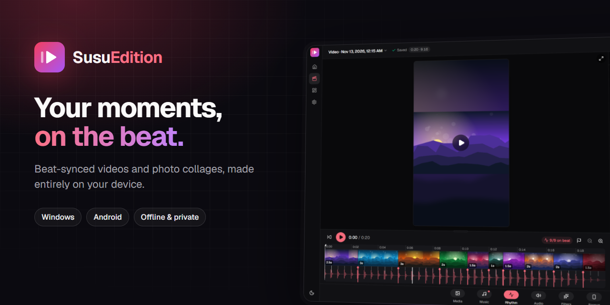
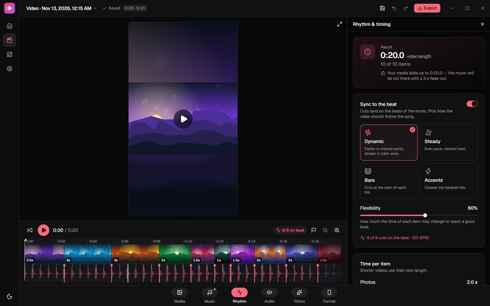
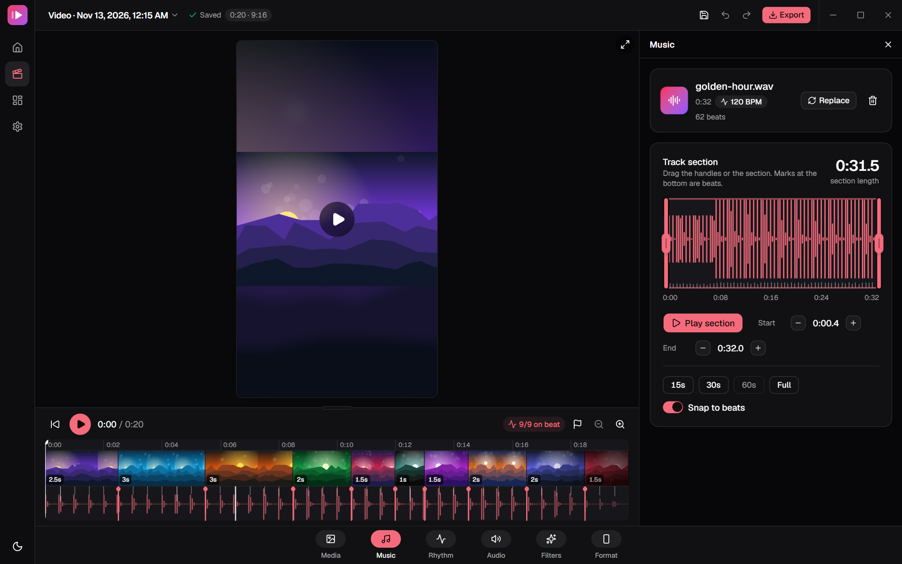
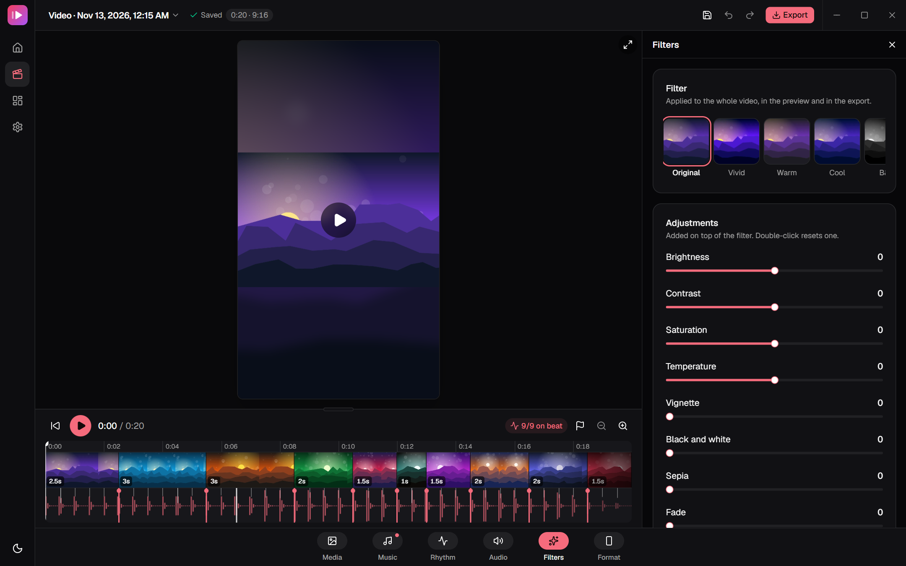
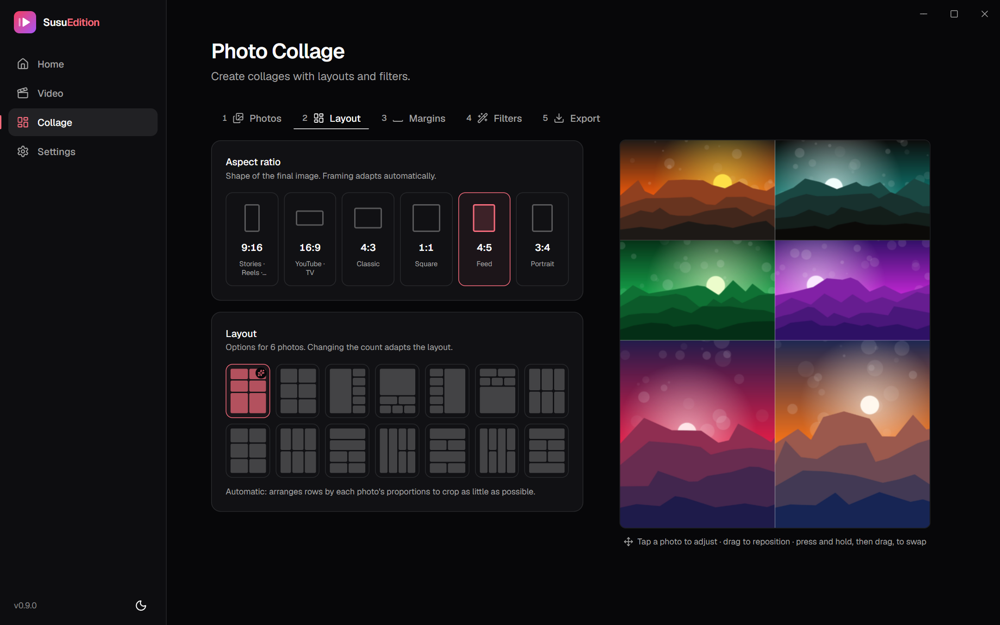
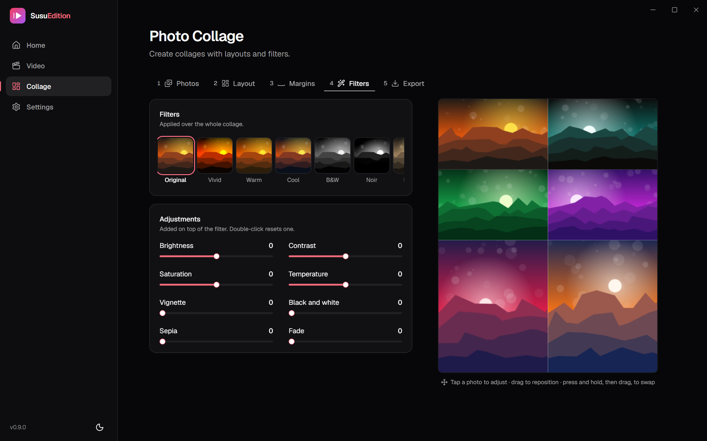
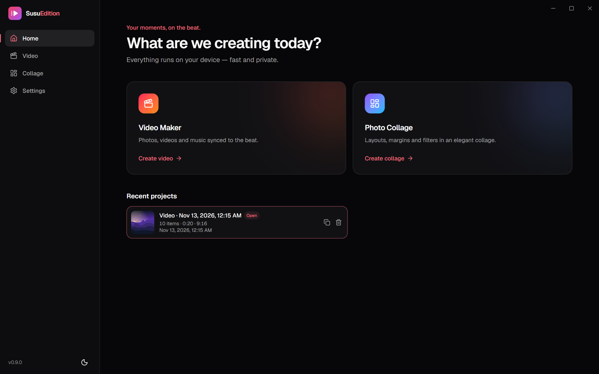

<p align="center">
  
</p>

<h1 align="center">SusuEdition</h1>

<p align="center">
  <strong>Beat-synced videos and photo collages, made entirely on your device.</strong><br />
  A fast, private photo &amp; video editor for <b>Windows 11</b> and <b>Android</b>.
</p>

<p align="center">
  <a href="https://github.com/klysman08/SusuEdition/releases/latest"></a>
  
  
  
</p>

<p align="center">
  <a href="#features">Features</a> ·
  <a href="#screenshots">Screenshots</a> ·
  <a href="#download">Download</a> ·
  <a href="#development">Development</a> ·
  <a href="#releases">Releases</a>
</p>

---

Drop in your photos, videos and a song — SusuEdition finds the beats and cuts your video right on them. Or arrange your favorite shots into a polished collage in seconds. Nothing is uploaded: decoding, analysis, rendering and export all run locally, using the GPU and hardware video encoders when available.

## Features

### 🎬 Video Maker

| Feature | What it does |
| --- | --- |
| **Beat sync** | Detects BPM and beats (Rust on desktop, TypeScript in the browser) and places every cut on a beat. Four styles: **Dynamic**, **Steady**, **Bars** and **Accents**, with adjustable flexibility. |
| **Song map** | Energy, bars and section changes (chorus, drop, break) drawn under the timeline, so the edit follows the song. |
| **Full-screen editor** | Always-visible preview, media + audio timeline, and a tool bar (Media, Music, Rhythm, Audio, Filters, Format). |
| **Manual timing** | Drag cut handles (snaps to beats and the playhead), reorder clips, ±0.1 s nudges, split at playhead (`S`), music markers (`M`). |
| **Trim & crop** | Trim videos with a frame strip and audio; crop any photo or video with free or fixed ratios. |
| **Per-clip look** | Filter preset + intensity, photo motion (zoom, pan, rise, impact, pulse, spin…) and entry transition per clip. |
| **Filters** | 10 presets and 8 manual adjustments applied to the whole video, in the preview and the export. |
| **Formats** | 9:16, 16:9, 4:3, 1:1, 4:5, 3:4 · fit / fill / stretch · blurred or solid background. |
| **Audio** | Music section picker with waveform, clip sound, volumes, ducking and automatic fade-out. |
| **Export** | MP4 (H.264 + AAC) at 720p, 1080p or 4K, 30/60 fps, streamed to disk with constant memory. |
| **Projects** | Autosave on every change, recent projects, undo/redo (`Ctrl+Z` / `Ctrl+Shift+Z`), `Ctrl+S` to save now. Media is referenced by path — never copied. |

### 🖼️ Photo Collage

| Feature | What it does |
| --- | --- |
| **Smart layouts** | Automatic justified rows that crop as little as possible, plus grids, spotlights and row/column combos for any number of photos. |
| **Aspect ratios** | Stories (9:16), YouTube (16:9), Classic (4:3), Square, Feed (4:5) and Portrait (3:4). |
| **Margins & style** | Outer margin, gap, rounded corners and background color — scaled to the export resolution. |
| **Per-photo framing** | Tap to select, drag to reposition, zoom, press-and-hold to swap photos. |
| **Filters** | The same 10 presets and 8 manual adjustments as the Video Maker. |
| **Export** | PNG or JPEG up to 4096 px, rendered off the main thread. |

### ✨ App

| Feature | What it does |
| --- | --- |
| **Native desktop window** | Frameless window on Windows with built-in window controls — no classic title bar. |
| **Animated icons** | Navigation and actions use [Animate UI](https://github.com/imskyleen/animate-ui) animated icons and Motion-powered components. |
| **Private by design** | Everything runs on your device; no account, no upload. |
| **Themes & languages** | Light, dark or system theme · English and Brazilian Portuguese. |
| **Update check** | Checks GitHub Releases on launch and every 6 hours and points you to the right installer. |
| **Fast media library** | Virtualized grid with cached thumbnails — 150 items reopen in ~60 ms. |

## Screenshots

<table>
  <tr>
    <td colspan="2"></td>
  </tr>
  <tr>
    <td width="50%"></td>
    <td width="50%"></td>
  </tr>
  <tr>
    <td width="50%"></td>
    <td width="50%"></td>
  </tr>
  <tr>
    <td colspan="2"></td>
  </tr>
</table>

## Download

Grab the latest build from the [**Releases**](https://github.com/klysman08/SusuEdition/releases/latest) page:

| Platform | File |
| --- | --- |
| Windows 10/11 (installer) | `SusuEdition_x.y.z_x64-setup.exe` |
| Windows 10/11 (MSI) | `SusuEdition_x.y.z_x64_en-US.msi` |
| Android 8.0+ | `SusuEdition_vx.y.z_android.apk` |

> The Windows installer downloads WebView2 automatically if it is missing (it ships with Windows 11).

## Tech stack

| Layer | Tools |
| --- | --- |
| Shell | [Tauri v2](https://v2.tauri.app) (Rust) — Windows and Android |
| UI | React 19, Vite, Tailwind CSS v4, [shadcn/ui](https://ui.shadcn.com), [Animate UI](https://animate-ui.com), Motion |
| Media engine | TypeScript: WebCodecs + [Mediabunny](https://mediabunny.dev) for decode/encode, WebGL2 compositor, Web Workers |
| Native | Rust: `susu://` protocol with HTTP Range, image processing, BPM/beat detection (Symphonia), disk cache |
| State & i18n | Zustand, react-router, i18next |

Architecture and decisions: [PLAN.md](PLAN.md) · [SPEC.md](SPEC.md) · [ROADMAP.md](ROADMAP.md) · [docs/adr](docs/adr) · [CHANGELOG.md](CHANGELOG.md)

## Development

### Requirements

| Tool | Version |
| --- | --- |
| Node.js | ≥ 22.12 |
| pnpm | 10 (`corepack enable`) |
| Rust | stable (≥ 1.85) |
| Windows | WebView2 (included in Windows 11), Visual Studio Build Tools (C++) |
| Android | Android Studio, SDK 35, NDK 27, JDK 17 |

### Android setup (once)

1. In **Android Studio** → SDK Manager install *Android SDK Platform 35*, *Platform-Tools*, *Build-Tools*, *NDK (Side by side)* and *Command-line Tools*.
2. Environment variables (PowerShell):
   ```powershell
   [Environment]::SetEnvironmentVariable("JAVA_HOME", "C:\Program Files\Android\Android Studio\jbr", "User")
   [Environment]::SetEnvironmentVariable("ANDROID_HOME", "$env:LOCALAPPDATA\Android\Sdk", "User")
   $ndk = Get-ChildItem "$env:LOCALAPPDATA\Android\Sdk\ndk" | Select-Object -Last 1
   [Environment]::SetEnvironmentVariable("NDK_HOME", $ndk.FullName, "User")
   ```
3. Rust targets:
   ```bash
   rustup target add aarch64-linux-android armv7-linux-androideabi i686-linux-android x86_64-linux-android
   ```
4. Generate the Android project: `pnpm tauri android init` (creates `src-tauri/gen/android`, which is versioned).

### Run

```bash
pnpm install
```

```bash
pnpm tauri dev
```

```bash
pnpm tauri android dev
```

`pnpm dev` opens only the frontend in the browser — handy for UI work (native features fall back to web implementations). Add `?frameless` to the URL to preview the Windows window chrome.

### Quality checks

```bash
pnpm lint && pnpm typecheck && pnpm test
```

```bash
cargo fmt --manifest-path src-tauri/Cargo.toml --all && cargo clippy --manifest-path src-tauri/Cargo.toml --all-targets -- -D warnings && cargo test --manifest-path src-tauri/Cargo.toml
```

### Project structure

```
src/
  app/          providers, routes, layouts (desktop sidebar / mobile bottom nav)
  components/   ui/ (shadcn), animate-ui/ (animated icons), common/ (shared)
  features/     one folder per feature (home, video-maker, photo-collage, settings…)
  engine/       pure-TS media engine (timeline, render, decode, audio, export, collage)
  platform/     typed bridge to Tauri (with browser fallbacks)
  i18n/         pt-BR and en
src-tauri/
  src/commands  commands exposed to the frontend
  src/services  native logic (thumbnails, beats, cache, projects)
  src/protocol  susu:// protocol with HTTP Range
```

## Releases

1. Update [CHANGELOG.md](CHANGELOG.md).
2. Bump the version and create the tag:
   ```bash
   pnpm version:bump 0.9.0 --tag
   ```
3. Push:
   ```bash
   git push --follow-tags
   ```

The [release workflow](.github/workflows/release.yml) builds the **`.exe` (NSIS)** and **`.msi`** for Windows and the **`.apk`** for Android, and publishes them on the tag's GitHub Release. Tags with a suffix become pre-releases — use a **numeric** suffix (e.g. `v0.9.0-1`), since the MSI installer (WiX) rejects suffixes like `-beta`.

### APK signing

Without configuration, CI signs the APK with a temporary key (it installs fine but **cannot update** a previous install). For a stable signature, create a keystore once and keep it safe:

```bash
keytool -genkeypair -v -keystore susuedition.jks -alias susuedition -keyalg RSA -keysize 2048 -validity 10000
```

Then add these repository secrets (Settings → Secrets and variables → Actions):

| Secret | Value |
| --- | --- |
| `ANDROID_KEYSTORE_BASE64` | the keystore in base64 (`base64 -w0 susuedition.jks`) |
| `ANDROID_KEYSTORE_PASSWORD` | keystore password |
| `ANDROID_KEY_ALIAS` | `susuedition` |
| `ANDROID_KEY_PASSWORD` | key password |

> ⚠️ Never commit the keystore. If it is lost, you can no longer publish updates for the same app.

## Credits

Created by [@klysman08](https://github.com/klysman08). Animated icons by [Animate UI](https://github.com/imskyleen/animate-ui).

## License

Proprietary — all rights reserved.
